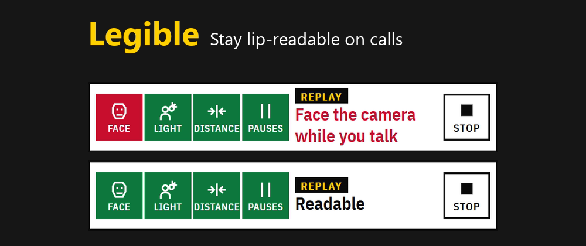
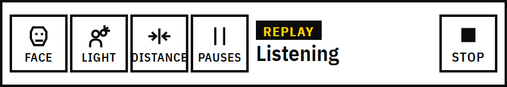
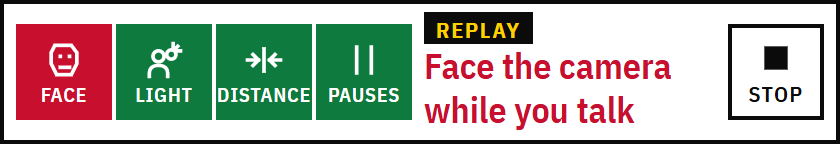
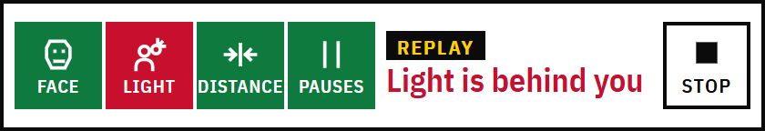
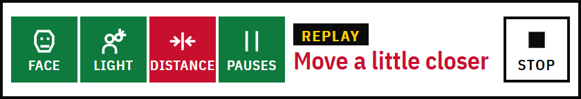
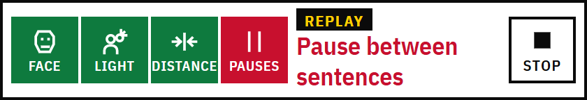
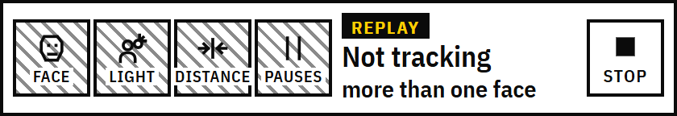
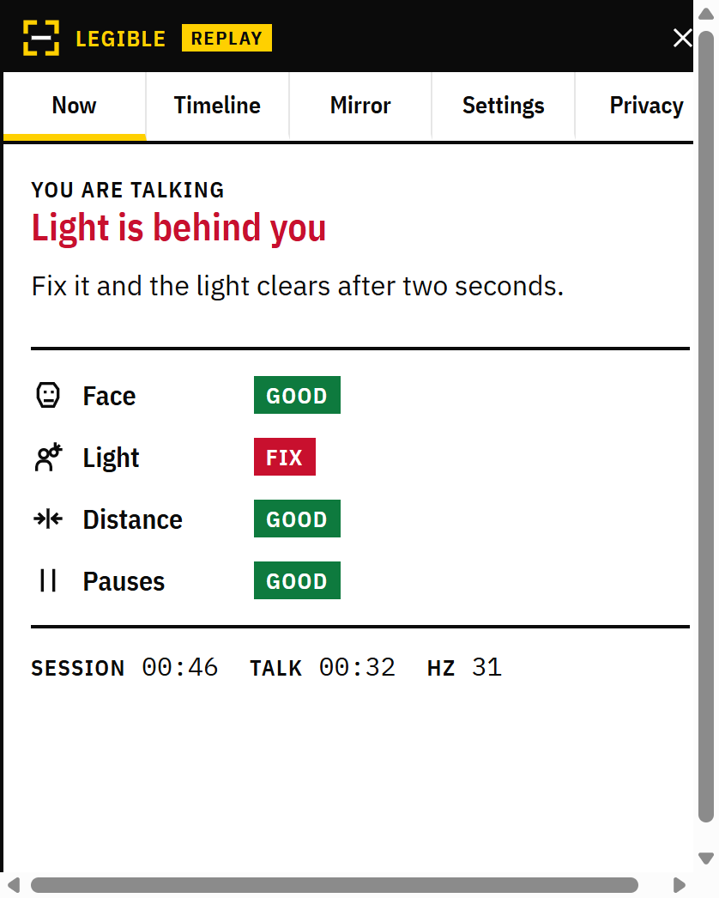
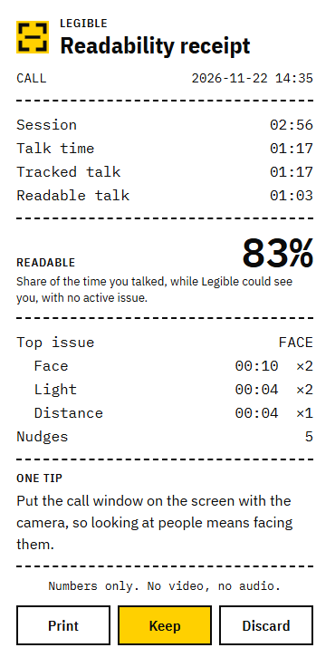

# Legible

**A private coach that keeps you lip-readable on video calls.**

People who lip-read need to see the speaker's face: turned towards them, lit from the front, close enough, at a normal pace. On calls, speakers turn to a second screen while talking, sit with a window behind them, drift back from the camera and rush. Legible is a small strip that sits under your webcam. It **stays quiet while you are readable** and gives **one short, private nudge, only while you are talking**, when you are not. After the call it shows a readability receipt.

Built with the [Presage SmartSpectra SDK](https://smartspectra.presagetech.com/docs) for the SmartSpectra SDK Challenge 2026.

**Challenge write-up:** [Legible on DEV](https://dev.to/zedaina/legible-a-private-coach-that-keeps-you-lip-readable-on-video-calls-23j)



**[▶ Narrated walkthrough on YouTube (3 min)](https://youtu.be/EnqeuEsMBN8)** ([MP4 in the repo](docs/media/legible-walkthrough.mp4)) — a synthetic, numbers-only replay driving the real app; narration by the open-source [Kokoro-82M](https://huggingface.co/hexgrad/Kokoro-82M) voice model.

| The strip, docked under the webcam | The panel | After the call |
| --- | --- | --- |
| <br><br><br><br><br> |  |  |

The receipt on the right is from a real 3-minute session on a laptop webcam (see [docs/RESULTS.md](docs/RESULTS.md)).

- No microphone. Talking is detected from lip movement.
- No recording. Nothing is sent to the people on your call.
- It coaches your own visibility only. It says nothing about anyone's hearing, emotions or health.

## How it works

| Light | Nudge | Signal |
| --- | --- | --- |
| **Face** | "Face the camera while you talk" | Head yaw from landmarks (nose tip vs. eye corners) more than 20° from your rehearsal baseline for 1 s, or SDK `FACE_NOT_FORWARD` for 1.5 s |
| **Light** | "Light is behind you" / "Your face is too dark" | Face vs. background brightness below 0.42, or face brightness below 45/255, for 3 s (160×90 frame, twice a second), or SDK `TOO_DARK` / `TOO_BRIGHT` for 1.5 s |
| **Distance** | "Move a little closer" | Mouth width (landmarks 61–291) below 3.5% of frame width for 3 s, or SDK `FACE_TOO_FAR` |
| **Pauses** | "Pause between sentences" | SmartSpectra's **chest breathing trace** (`breathingMetrics`): more than 25 s of talking without a pause that has an inhale in it. Shows "No data" (never an issue) if the SDK cannot see your chest |
| **Pace** *(experimental, off by default)* | "Slow down a little" | Visible syllables (peaks in lip opening) per second of talking, over 10 s, more than 1.3× your rehearsal rate. On a real face fast talk opened the lips *less*, so this did not work; see [RESULTS](docs/RESULTS.md) |

Every check is gated on SmartSpectra's **talking** signal, with a 700 ms hangover (hold timers survive pauses of up to 1.5 s between phrases). While you listen, the lights stay neutral and nothing is judged. When Legible cannot see exactly one face, it shows a grey hatched **Not tracking** state. It never shows an issue it cannot see, and it leaves that time out of the receipt.

**Nudge engine:** one nudge at a time (priority Face > Light > Distance > Pauses); a nudge clears after 2 s of good state; at most one new nudge every 5 s; the same nudge does not repeat within 30 s unless it lasted more than 10 s. All thresholds, with comments, are in [`rules/thresholds.ts`](rules/thresholds.ts).

**Receipt:** talk time, tracked talk time, **readable %** (tracked talk time with no active issue ÷ tracked talk time), top issue and one tip. Print, Keep or Discard.

Optional checks (Settings, off by default): **Pace** (experimental; see the table) and **Mouth** (experimental; hand over the mouth). **Pauses** is on by default and can be switched off; while it is on, Legible requests the `breathingMetrics` bundle.

## Run it

Requirements: Node 20+, and Windows x64, macOS Apple Silicon or Linux x64/ARM64 (glibc 2.35+). These are the SmartSpectra Node SDK platforms.

```bash
git clone <this repo> legible && cd legible
npm install
npm run build
npm start                # or: npm run dev
```

### Replay mode (no key, no camera)

```bash
npm run build
npm run replay
```

Or press **Watch a replay** on the welcome screen. It plays `fixtures/demo.json`, a **synthetic**, numbers-only session, through the same engine, strip, panel and receipt; the strip shows a **REPLAY** tag. `LEGIBLE_REPLAY_SPEED=4` plays it faster.

### With your SmartSpectra key

1. **Welcome → Use in a call** (or **Rehearse**). Read the consent and press **I agree**.
2. **Setup:** paste your API key. It is stored encrypted with the OS keychain via Electron `safeStorage`.
3. Choose a camera and press **Check**. **Check this computer** runs the SDK's readiness check (~25 s; sit in front of the camera).
4. **Rehearse** once (8 short sentences). This sets your head-angle and pace baseline.
5. Start a call. The strip docks at the top of the screen; drag it and it snaps back to the top edge. Click the lights for the panel (Now, Timeline, Mirror, Settings, Privacy). **Ctrl/Cmd+Shift+L** starts and stops sensing.

## Two camera paths

- **Direct:** Legible and your call app read the same webcam. This usually works on macOS. On Windows, many webcams serve one app at a time; Setup → Check tells you, and "Camera is busy" links to the guide.
- **OBS Virtual Camera:** OBS (separate software) reads the physical webcam; both your call app and Legible read "OBS Virtual Camera". Legible does not control OBS. See [docs/OBS-GUIDE.md](docs/OBS-GUIDE.md).

Setup picks a real webcam by default. Virtual and screen-mirroring cameras (OBS Virtual Camera, TranScreen and similar) are listed, but you choose them yourself. Only one Legible or SmartSpectra app should hold a webcam at a time on Windows: close other camera apps, or put them all on OBS Virtual Camera.

If neither path works, **Rehearsal** is a full product on its own: practise before the call, then compare two practice receipts (before/after).

## Consent and data handling

Camera only after in-app consent, and only during Rehearsal or a session, with a yellow **CAM** tag. No microphone, no recording, no screen capture. Stored on disk: settings, baseline, receipts you keep, and the encrypted key, all in one folder. **Privacy → Delete everything** removes that folder. SDK telemetry is **off**; the SDK still checks its licence online. Full details are in [docs/PRIVACY.md](docs/PRIVACY.md).

## Project layout

```
app/main/        windows, IPC bus, key store, storage, readiness check
app/preload/     sensor.ts (SmartSpectra bridge + sensor channel), ui.ts (narrow UI API)
windows/sensor/  sdk.ts (all SDK calls), decode, gate, frameProbe, features/, checks/, nudgeEngine, receiptLog, analyzer, record, replay, session
windows/strip | panel | receipt | setup   Preact UIs
windows/ui/      shared components (lights, pictograms, settings, privacy)
shared/          types, IPC contract, strings, tokens.css
rules/           thresholds.ts
fixtures/        synthetic numbers-only sessions (scripts/make-fixtures.mjs)
tests/unit       Vitest   tests/e2e  Playwright for Electron (replay mode)
docs/            SDK-NOTES, OBS-GUIDE, PRIVACY, RESULTS
```

The hidden sensor window owns the camera, the SDK and the analysis (`backgroundThrottling: false`, verified at ~30 Hz while hidden). It broadcasts a small `LegibleState` through the main process to the visible windows. The analyser is pure and deterministic, so live sessions, replay and the unit tests run the same code.

## Tests

```bash
npm test            # unit: checks, engine rules, receipt maths on fixtures, privacy scan
npm run test:e2e    # Electron multi-window flow in replay mode
npm run typecheck
```

Real-camera check (needs a stored key and a person at the camera; a prompt window guides each step, ~4 min):

```bash
npm run build
node scripts/live-check.mjs          # add --no-rehearsal to skip the rehearsal
node scripts/live-report.mjs         # per-step summary of the last run
```

Results are in [docs/RESULTS.md](docs/RESULTS.md).

## Limitations

- Thresholds were first set from synthetic fixtures, then tuned on **one** real session (one person, HP Wide Vision laptop camera; see [docs/RESULTS.md](docs/RESULTS.md)). Other cameras, faces and rooms may need different values. The SDK sends 478 MediaPipe-order landmarks in pixels, confirmed on that session.
- Pace from lip movement did not work on a real face (fast talk opens the lips less), so it is off by default.
- When a head turns far away, the SDK may lose the face. Legible then shows "Not tracking" rather than a Face nudge, by design.
- A hand over the mouth may not change the landmarks; the Mouth check is experimental and off by default.
- The SDK needs an internet connection for licence checks.

## Licence

MIT — see [LICENSE](LICENSE). The SmartSpectra SDK is Presage Technologies' and has its own licence and terms.

## Credits

- [Presage SmartSpectra SDK](https://smartspectra.presagetech.com/) (`@smartspectra/node-sdk` 3.5.0)
- [Electron](https://www.electronjs.org/), [electron-vite](https://electron-vite.org/), [Preact](https://preactjs.com/), [Vitest](https://vitest.dev/), [Playwright](https://playwright.dev/)
- [IBM Plex](https://github.com/IBM/plex) Sans, Sans Condensed and Mono (SIL Open Font License), via Fontsource
- Pictograms drawn for Legible in the Tabler style (no Tabler code included)
- Walkthrough narration: [Kokoro-82M](https://huggingface.co/hexgrad/Kokoro-82M) (Apache 2.0) via `kokoro-js`
- Communication guidance: [RNID](https://rnid.org.uk/information-and-support/hearing-loss/communication-tips/), [City Lit](https://www.citylit.ac.uk/blog/talking-to-people-with-hearing-loss)

SmartSpectra metrics are for general wellness and information only. Legible makes no medical claims.
