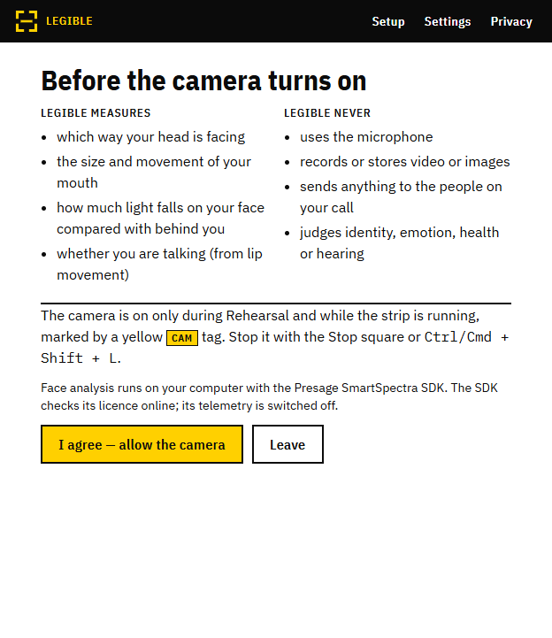
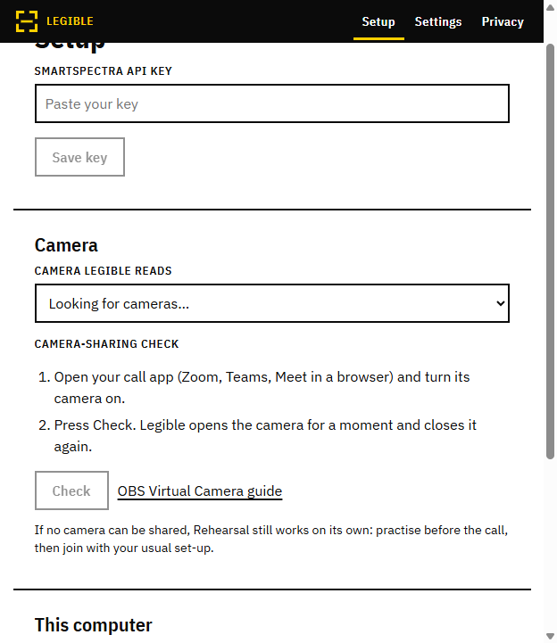
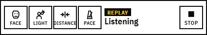
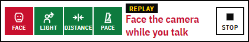
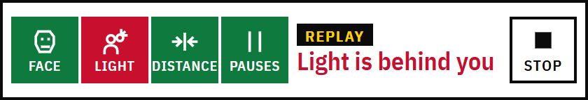
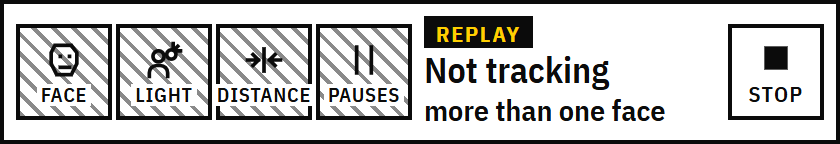
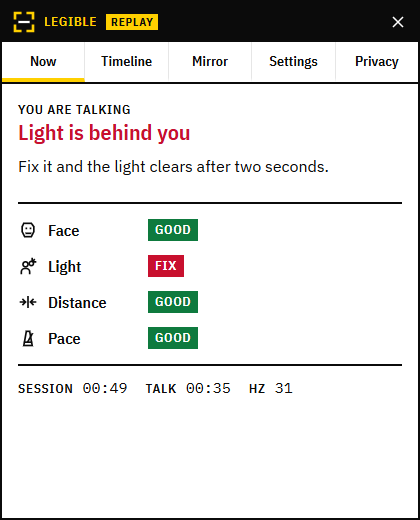
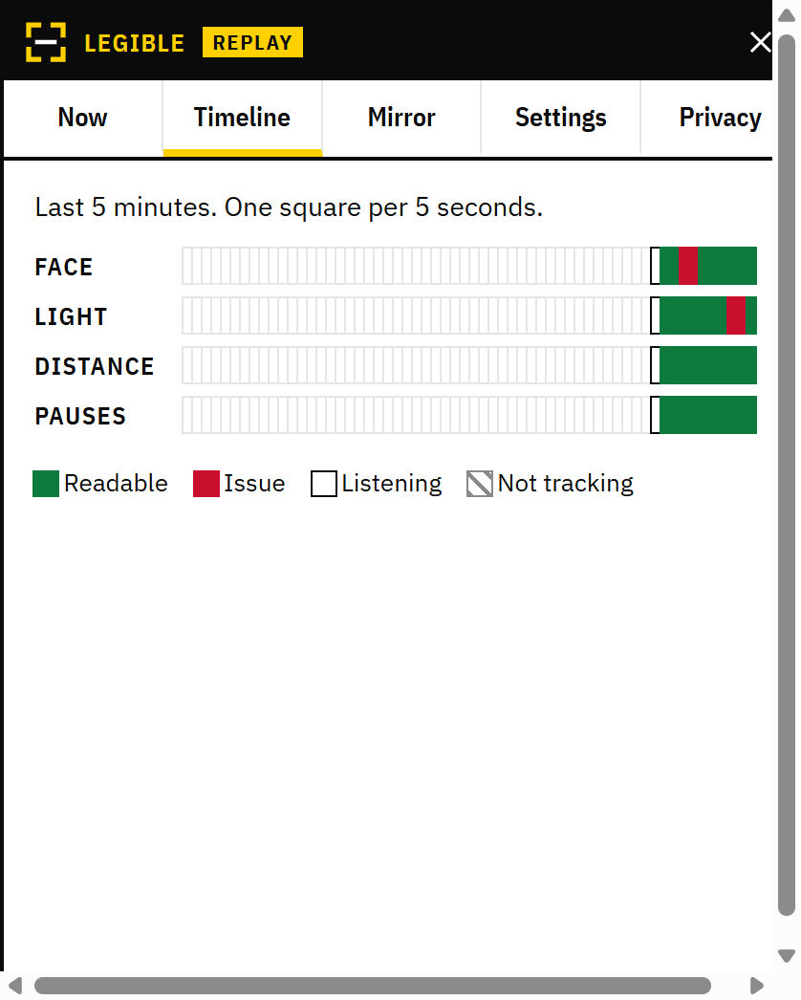
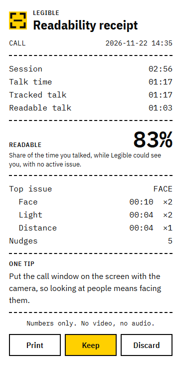
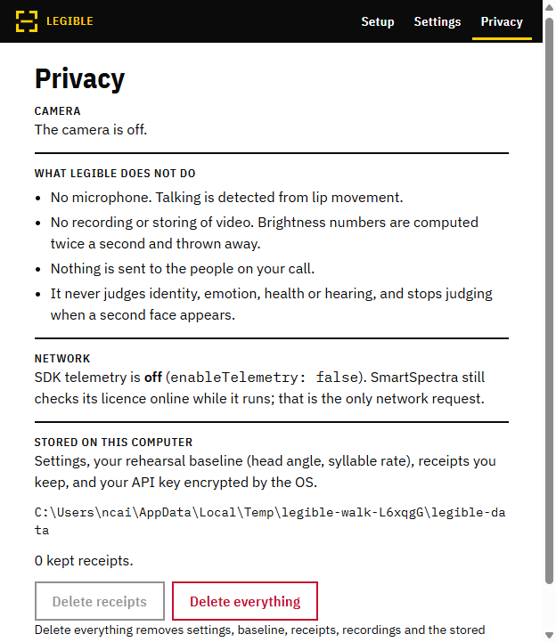

*This is a submission for the [Presage SmartSpectra SDK Challenge 2026](https://dev.to/challenges/presage-2026-11-04).*

## The problem: you can't see yourself from their side

On a video call, someone who lip-reads depends on one thing you control: **your face.** It needs to be turned towards them, lit from the front, close enough to see your lips, and moving at a pace they can follow.

We break all four without noticing:

- you glance at your **second screen** mid-sentence, and your lips are now in profile;
- you sit with a **bright window behind you**, and your face goes dark;
- you **lean back** in your chair, and your mouth shrinks to a few pixels;
- you **rush** when you are nervous.

Nobody tells you. A colleague who lip-reads usually won't interrupt the meeting to say "I lost you when you turned". By the end of the call they have missed half of it, and you never knew.

**Legible** closes that gap. It is a small desktop strip under your webcam that watches **your own face only**, and tells **only you** when you are hard to lip-read, **only while you are talking**.

## Demo



*(The narrated walkthrough plays a synthetic, numbers-only session through the real app, labelled REPLAY. Narration: the open-source Kokoro-82M voice model.)*

**Code:** https://github.com/ainazulfiqar99acc/legible

## How you use it

### 1. Set up once (2 minutes)

Install, open Legible, and read the consent screen. It says what Legible measures, what it **never** does (microphone, recording, sending anything to the call), and how to stop it. The camera stays off until you agree.




Paste your SmartSpectra API key (stored encrypted by your operating system) and choose a camera. Legible picks your real webcam by default, not a virtual or screen-mirroring camera.



### 2. Rehearse (1 minute)

Read eight short sentences out loud, such as *"The meeting will start at ten past nine."*. Legible learns how **you** normally hold your head, so a later nudge means "you turned away from *your* normal", not from some average face. You also get a practice receipt, and you can rehearse again after fixing your set-up to compare before and after.

### 3. Join your call

Start Legible with the button or **Ctrl/Cmd+Shift+L**. The strip docks at the top of the screen, right under the webcam, where your eyes already are. A yellow **CAM** tag shows the camera is on.

Most of the time it does **nothing**. That is the point.

**While you listen**, the lights stay neutral. Legible does not judge you when you are not speaking. Look away, check your notes, drink your coffee.



**While you talk and are readable**, the lights are green.


**When you are not readable**, one light turns red, with one short instruction:






Fix it, and the light goes green again after two seconds. There is never more than one nudge at a time, at most one new nudge every five seconds, and the same nudge does not come back within 30 seconds. It should feel like a quiet tap on the shoulder, not an alarm.

**When Legible can't see you properly**, it says so instead of guessing. If you cover the camera, walk away, or **someone else leans into the frame**, the lights turn grey and hatched, and judging stops. Legible never assesses anyone but you.



Click the lights for the panel: what is happening now, and a timeline of the call so far.





### 4. After the call: the readability receipt

When you stop, you get a receipt: how long you talked, **the share of that time you were readable**, your top issue, and **one** concrete tip. Print it, keep it, or discard it.

This one is from a **real** 3-minute session on my laptop webcam, where I deliberately turned away, leaned back and switched the light off:



Its tip, *"Put the call window on the screen with the camera, so looking at people means facing them"*, is the single most useful change most of us can make, and Legible only suggests it when Face really was your top issue.

### 5. Your data stays yours

The Privacy screen shows the one folder Legible uses. **Delete everything** empties it.



## Who it's for

- **Anyone with a colleague, student, client or relative who lip-reads**, on Zoom, Teams, Meet or any call app. Legible works next to them; it doesn't plug into them.
- **Teachers and presenters** giving remote lessons, where one turned head can lose a student for a whole explanation.
- **Interviewers and managers** who want to be easy to follow without anyone having to ask.
- **Practice on your own:** Rehearsal works with no call at all, so you can fix your desk set-up once (lamp in front, call window under the camera, chair a little closer) and check it with a before/after receipt.

Legible coaches **the speaker's visibility**. It says nothing about anyone's hearing, emotions or health, and it puts no burden on the person who lip-reads.

## How I used SmartSpectra

Legible runs the SmartSpectra Node SDK (3.5.0) in a hidden Electron window and asks for exactly two metrics, **`FACE_LANDMARKS`** and **`TALKING`**, plus the SDK's **validation status** codes. Each one drives a specific behaviour:

| SmartSpectra signal | What Legible does with it |
| --- | --- |
| **`TALKING`** | Gates every check. Nudges only happen while SmartSpectra says you are talking (with a 700 ms hangover). This is also how Legible detects speech **without a microphone**: the talking signal comes from the face. |
| **`FACE_LANDMARKS`** (478 points) | Head yaw from the nose tip vs. the outer eye corners, projected on the eye line so head *roll* does not read as a turn; mouth width (corners 61–291) for distance; lip opening; and the face box that tells the light probe where your face is. |
| **Validation codes** | Signals that normally say "this vitals reading is unreliable" become coaching for a listener: `FACE_NOT_FORWARD` → Face, `TOO_DARK`/`TOO_BRIGHT` → Light, `FACE_TOO_FAR` → Distance. `NO_FACE_FOUND` and `MULTIPLE_FACES_FOUND` → **Not tracking**. |

| Light | Nudge | Rule |
| --- | --- | --- |
| Face | "Face the camera while you talk" | Head more than 20° from your rehearsal baseline for 1 s, or `FACE_NOT_FORWARD` for 1.5 s |
| Light | "Light is behind you" / "Your face is too dark" | Face/background brightness below 0.42, or face brightness below 45/255, for 3 s (a 160×90 probe, twice a second, pixels zeroed after use), or `TOO_DARK`/`TOO_BRIGHT` |
| Distance | "Move a little closer" | Mouth width below 3.5% of the frame width for 3 s, or `FACE_TOO_FAR` |

**When it can't see you, it says so.** Time when Legible can't see exactly one face is left out of the receipt, so the readable percentage is honest.

## Testing it on a real face

The first thresholds came from synthetic data, so I ran a scripted 3-minute live session on an HP laptop webcam. An on-screen prompt walked me through talking, turning about 30°, turning away silently, covering the lens, leaning back, talking fast and switching the room light off. Legible recorded only numbers: landmark points, the talking flag and brightness means.

**What worked straight away:**

- The SDK sends **478 landmarks in pixel coordinates** (MediaPipe order), so the indices were right.
- **Face** nudged **0.5 s** after I started talking while turned. Turning away **silently**: no nudge.
- **Covered lens:** "Not tracking" within about a second.
- **Stop:** camera off and receipt open in **0.9 s**.

**What broke, and what I changed** (every number is in [`rules/thresholds.ts`](https://github.com/ainazulfiqar99acc/legible/blob/main/rules/thresholds.ts), with the measurement in a comment):

- **The talking flag flickers inside a sentence.** Runs had a median of 0.37 s and gaps a median of 0.18 s, so three-second "hold" rules never completed. Fix: a longer hangover, plus hold timers that survive pauses of up to 1.5 s.
- **A wide-angle laptop camera makes everyone look far away.** My mouth was 5–6.6% of the frame width at a normal seat, against a 6% limit. Leaning back it was about 2%. The limit is now 3.5%.
- **A normal room is mildly backlit.** Face vs. background was 0.55–0.65 in ordinary light. The backlight limit went from 0.6 to 0.42, and a "face too dark" check now catches the light going off (face brightness fell from 75 to about 25).
- **Single-frame `MULTIPLE_FACES_FOUND` glitches** (31–78 ms) appeared with only me in the room. They are now debounced at 250 ms.
- **Pace from lip movement didn't work.** When I talked fast, my lips opened *less*, so counting lip openings read fast speech as *slower*. Pace is now **off by default and labelled experimental**. I'd rather ship three checks that work than four that nag.

Replayed through the tuned rules, the same recording gave exactly the right nudges: Face when turned, Distance when leaning back, Light when the room went dark, and none in between. 87 unit tests and 4 Electron end-to-end tests run the same analyser.

## Privacy and consent

> Legible looks at your own face to tell you, privately, when you are hard to lip-read. It never uses the microphone, records nothing, and shares nothing with the people on your call. SmartSpectra runs on your computer, checks its licence online, and telemetry is off.

- The camera opens only after in-app consent, only during Rehearsal or a session, marked by a yellow **CAM** tag. **Ctrl/Cmd+Shift+L** stops it.
- No microphone (`audio: false` everywhere; microphone permission is always denied), no video recording, no screen capture.
- The API key is encrypted with the OS keychain (Electron `safeStorage`), handed only to the hidden sensor window, and never logged.
- **Privacy → Delete everything** removes the one data folder.
- SmartSpectra metrics are for general wellness and information only. Legible makes no medical claims.

## How it's built

- **Electron, with multiple windows.** A hidden sensor window (`backgroundThrottling: false`, about 30 Hz while hidden) owns the camera, the SDK and a **pure, deterministic analyser**. The strip, panel, setup and receipt are small **Preact** windows that get state through the main process.
- **The same analyser everywhere.** Live sessions, the REPLAY mode (for judges without a key) and the unit tests run the same code on the same numbers-only events.
- **Camera sharing:** on Windows a webcam often serves one app at a time. Setup checks this and explains the OBS Virtual Camera route, and Rehearsal works on its own.

**Try it without a key or a camera:**

```bash
git clone https://github.com/ainazulfiqar99acc/legible && cd legible
npm install && npm run build && npm run replay
```

## Limitations and what's next

- The thresholds are tuned on **one** person, camera and room. Next: more people, and a lip-reading benefit test (viewers transcribe muted clips recorded with and without Legible's tips).
- Camera sharing with Zoom/Teams/Meet needs measuring on more machines.
- Pace needs a better signal than counting lip openings.

## Credits

Presage SmartSpectra SDK · Electron · electron-vite · Preact · Vitest · Playwright · IBM Plex (OFL) · Kokoro-82M (Apache 2.0) for the narration · communication guidance from [RNID](https://rnid.org.uk/information-and-support/hearing-loss/communication-tips/) and [City Lit](https://www.citylit.ac.uk/blog/talking-to-people-with-hearing-loss).
