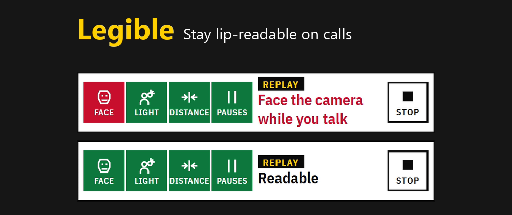
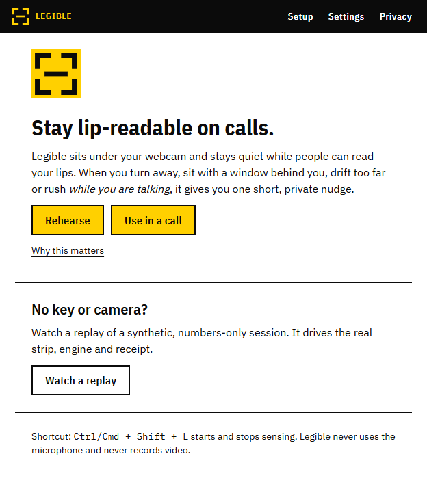
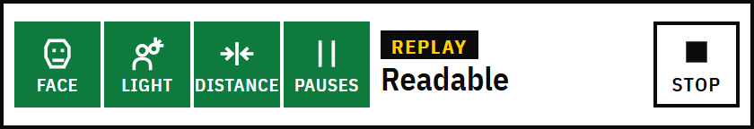
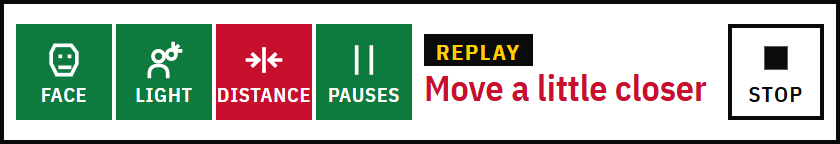

*This is a submission for the [Presage SmartSpectra SDK Challenge](https://dev.to/challenges/presage-2026-11-04)*

## What I Built

On a video call, someone who lip-reads depends on one thing the speaker controls: **the speaker's face.** It needs to be turned towards them, lit from the front, and close enough to see the lips.

We break all of this without noticing. We glance at a **second screen** mid-sentence, sit with a **bright window behind us**, and **lean back** until our mouth is a few pixels wide. Nobody tells us. A colleague who lip-reads rarely interrupts a meeting to say "I lost you when you turned".

**Legible** is a small desktop strip that docks under your webcam. It watches **your own face only**, stays **quiet while you are readable**, and when you are not, **only while you are talking**, gives **you alone** one short nudge. After the call you get a **readability receipt**: how long you talked, the share of it you were readable, your top issue and one tip.



### How you use it

**1. Set up once.** Open Legible and read the consent screen. The camera stays off until you agree. Paste your SmartSpectra API key (stored encrypted by your operating system) and pick a camera. Legible chooses your real webcam by default, never a virtual one.




**2. Rehearse (1 minute).** Read eight short sentences out loud, such as *"The meeting will start at ten past nine."*. Legible learns how **you** normally hold your head, so a nudge means "you turned away from *your* normal". It works with no call at all, so you can fix your desk set-up first and compare practice receipts before and after.

**3. Join your call.** Press Start or **Ctrl/Cmd+Shift+L**. The strip docks at the top of the screen, right under the webcam, where your eyes already are. Most of the time it does nothing.

| While you listen: neutral, nothing judged | While you talk and are readable |
| --- | --- |
|  |  |

When you are hard to lip-read, one light turns red with one instruction. Fix it, and it goes green after two seconds:




Click the lights for the panel, with what is happening now and a timeline of the call:

| Now | Timeline |
| --- | --- |
|  |  |

**4. After the call: the receipt.** This one is from a **real** 3-minute session on my laptop webcam, where I deliberately turned away, leaned back and switched the light off:


Legible coaches **the speaker's visibility**. It says nothing about anyone's hearing, emotions or health, and it puts no burden on the person who lip-reads.

## Demo



The narrated walkthrough plays a synthetic, numbers-only session through the real app, labelled **REPLAY**, so you can see every nudge in under three minutes. The narration uses the open-source Kokoro-82M voice model. The receipt above, and the measurements under *How It Responds to Human Signals*, come from a live session on a real webcam.

## Code

**https://github.com/ainazulfiqar99acc/legible** (MIT)

The README has full setup instructions. To try it **without a key or a camera**:

```bash
git clone https://github.com/ainazulfiqar99acc/legible && cd legible
npm install && npm run build && npm run replay
```

With a key: `npm start`, then Welcome → Use in a call → consent → paste key → choose camera → Rehearse. Requirements: Node 20+, and Windows x64, macOS Apple Silicon or Linux x64/ARM64 (the SmartSpectra Node SDK platforms).

## How It Responds to Human Signals

Legible runs the **SmartSpectra Node SDK 3.5.0** in a hidden Electron window and asks for exactly two live metrics, **`TALKING`** and **`FACE_LANDMARKS`**, plus the SDK's **validation status**. Every one of them drives a visible behaviour in real time:

| Live Presage signal | How the experience responds |
| --- | --- |
| **`TALKING`** (talking detection) | Gates everything. The lights judge you **only while SmartSpectra says you are talking**, with a 700 ms hangover. Turn away while you *listen* and nothing happens; start talking while turned and the Face nudge appears within about a second. This is also how Legible knows you are speaking **without a microphone**. |
| **`FACE_LANDMARKS`** (478 points) | **Face:** head yaw from the nose tip vs. the outer eye corners (projected on the eye line so head *roll* doesn't count). More than 20° from your rehearsal baseline for 1 s → "Face the camera while you talk". **Distance:** mouth width (corners 61–291) below 3.5% of the frame for 3 s → "Move a little closer". **Light:** the face box tells a 160×90 brightness probe where your face is; face/background below 0.42, or face brightness below 45/255, for 3 s → "Light is behind you" / "Your face is too dark". |
| **Validation status** | Codes that normally mean "this reading is unreliable" become coaching for a listener: `FACE_NOT_FORWARD` → Face, `TOO_DARK`/`TOO_BRIGHT` → Light, `FACE_TOO_FAR` → Distance. `NO_FACE_FOUND` and **`MULTIPLE_FACES_FOUND`** → a grey hatched **"Not tracking"**: judging stops, so Legible never assesses anyone but you. |


**One nudge at a time.** A small engine sits between the signals and the strip. Priority is Face > Light > Distance. A nudge clears after 2 s of good state. There is at most one new nudge every 5 s, and the same nudge doesn't repeat within 30 s. It should feel like a tap on the shoulder, not an alarm. Time when Legible can't see exactly one face is left out of the receipt, so the readable percentage is honest.

### Integrating the SDK

- **Main process:** `bindSmartSpectraIpc(sensorWindow)`. **Sensor preload:** `@smartspectra/node-sdk/preload`.
- **Hidden sensor window:** `getUserMedia({ audio: false, video })`, then `new SmartSpectraSDK({ apiKey, requestedMetrics: [FACE_LANDMARKS, TALKING], enableTelemetry: false })`, `sdk.useMediaStream(stream)` and `await sdk.start()`.
- **Events:** `sdk.on('metrics')` → `decodeMetrics()` → compact numbers-only events (7 landmark points + face box, the talking flag), and `sdk.on('validationStatus')`. The SDK's microsecond timestamps are mapped to session time.
- **The analyser:** pure and deterministic. The same code runs live, in REPLAY mode (for judges without a key) and in 87 unit tests. Stop order: camera tracks first (the camera light goes off at once), then `sdk.stop()`, then `destroy()`.
- The window keeps `backgroundThrottling: false`, so it runs at about 30 Hz while hidden. Every SDK call is in one file, [`windows/sensor/sdk.ts`](https://github.com/ainazulfiqar99acc/legible/blob/main/windows/sensor/sdk.ts), checked against the installed typings ([`docs/SDK-NOTES.md`](https://github.com/ainazulfiqar99acc/legible/blob/main/docs/SDK-NOTES.md)).

### Tuned on a real face

I ran a scripted 3-minute live session on an HP laptop webcam: talking, turning about 30°, turning away silently, covering the lens, leaning back, talking fast, and switching the room light off.

- **Worked straight away:**
  - 478 landmarks in pixels (MediaPipe order).
  - **Face nudge 0.5 s** after I started talking while turned, and **no nudge** when turned away silently.
  - "Not tracking" within about 1 s when I covered the lens.
  - Camera off and receipt open **0.9 s** after Stop.
- **The talking signal flickers inside sentences** (median run 0.37 s, median gap 0.18 s), so I lengthened the hangover and made hold timers survive pauses of up to 1.5 s.
- **A wide-angle laptop camera makes everyone look far away.** My mouth was 5–6.6% of the frame width at a normal seat and about 2% leaning back, so the limit went from 6% to 3.5%.
- **Ordinary rooms are mildly backlit** (face/background 0.55–0.65), so the backlight limit went from 0.6 to 0.42. A "face too dark" check now catches the light going off (brightness 75 → 25).
- **Single-frame `MULTIPLE_FACES_FOUND` glitches** (31–78 ms) appeared with one person in the room. They are now debounced at 250 ms.
- **Pace from lip movement failed:** fast speech opened my lips *less*. It is now off by default and labelled experimental. Three checks that work beat four that nag.

Replayed through the tuned rules, the same recording gave exactly the right nudges and no false ones. Each number sits in [`rules/thresholds.ts`](https://github.com/ainazulfiqar99acc/legible/blob/main/rules/thresholds.ts) next to its measurement.

## Prize Categories

**Best Thoughtful Real-World Use.**

**The need.** People who lip-read lose parts of every video call when speakers turn away, sit backlit or drift back from the camera. The speaker can't see it happen, and the listener has to keep asking. Legible fixes it at the source, with the speaker, without asking anything of the person who lip-reads.

**Who it's for.** Anyone with a colleague, student, client or relative who lip-reads: teams on Zoom, Teams or Meet, teachers giving remote lessons, interviewers and managers. Legible runs next to any call app; it doesn't plug into it.

**Designed to be usable by those people:**
- **Silent by default.** No numbers or scores on screen during a call, and nothing while you listen.
- **One short instruction at a time.** Each one says what to do ("Move a little closer"), not what is wrong with you.
- **Honest.** When Legible can't see one face clearly it says "Not tracking" instead of guessing, and that time is left out of the receipt.
- **Personal.** Rehearsal sets your own baseline, so the head-angle check is relative to how you normally sit.
- **Easy to see and use.** High-contrast lights with pictograms and words (never colour alone), large text, full keyboard use, and a global shortcut.
- **Works without a call.** Rehearsal plus before/after receipts let you fix your desk set-up once, for example a lamp in front and the call window under the camera.
- **Grounded in real advice:** communication guidance from [RNID](https://rnid.org.uk/information-and-support/hearing-loss/communication-tips/) and [City Lit](https://www.citylit.ac.uk/blog/talking-to-people-with-hearing-loss).

## Consent and Data Handling

> Legible looks at your own face to tell you, privately, when you are hard to lip-read. It never uses the microphone, records nothing, and shares nothing with the people on your call. SmartSpectra runs on your computer, checks its licence online, and telemetry is off.

- **Camera consent.** An in-app consent screen comes before any camera access. It lists what is measured and what is never done, and how to stop. Until you agree, the app's permission handler refuses camera access. Afterwards it grants **video only**.
- **Visible camera state.** The camera is on only during Rehearsal or a session, marked by a yellow **CAM** tag. Stop, closing the strip, or **Ctrl/Cmd+Shift+L** turns it off.
- **No microphone, no recording, no screen capture.** `audio: false` everywhere, and microphone permission is always denied. Frames are never stored. The brightness probe reads a 160×90 copy twice a second and zeroes its pixels after use.
- **Storage.** All data is in one local folder: settings, your rehearsal baseline (head angle and lip-movement numbers), receipts **you choose to Keep**, and the API key, **encrypted** with the OS keychain (Electron `safeStorage`). The key is only given to the hidden sensor window and never logged. An optional, **off-by-default** developer setting saves numbers-only recordings (a few landmark points, no images) for tuning.
- **Sharing.** Nothing is sent to the people on your call or to any server of mine. The SmartSpectra SDK runs on-device and contacts Presage to check its licence.
- **Retention and deletion.** Receipts are discarded unless you press Keep. **Privacy → Delete everything** removes the whole folder.
- **SDK telemetry:** **off** (`enableTelemetry: false`). No other AI services are used in the app. The demo narration was generated offline with Kokoro-82M.
- **No medical claims.** SmartSpectra metrics are for general wellness and information. Legible doesn't diagnose, treat or assess anyone's hearing, and it can't monitor anyone covertly. It only works on the person who switched it on, in front of their own camera, and it stops judging when a second face appears.


